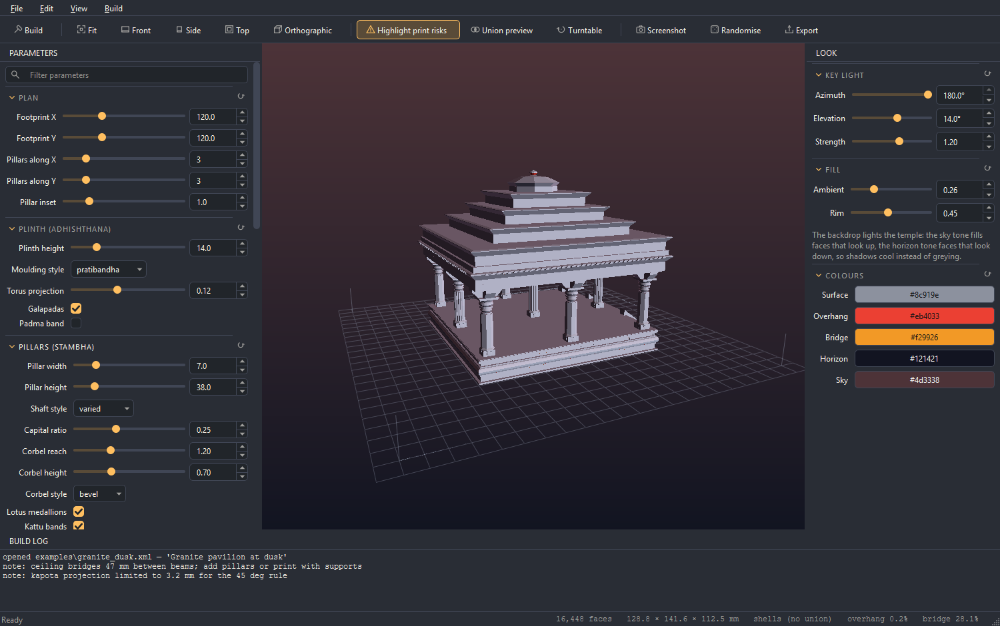
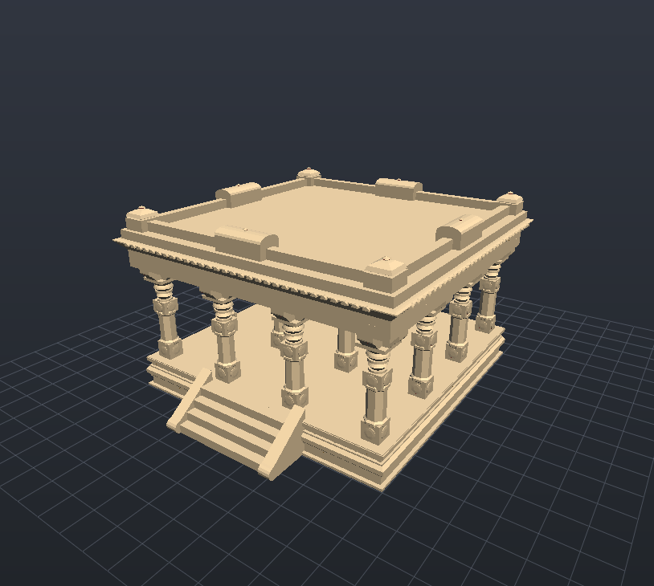
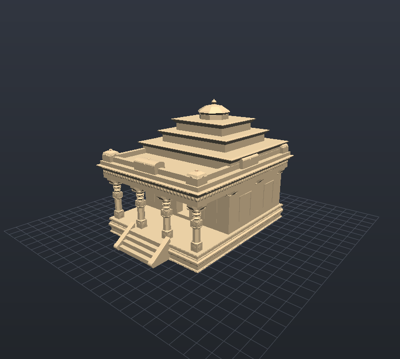

# proc_gen_temple

A parametric generator for a small **Dravidian mandapa** — the pillared pavilion of a
South-Indian temple — with a **garbhagriha** for the vigraham when you want one, that
exports a 3D-printable STL or 3MF. Sixty-one knobs describe the building in the
vocabulary of the shilpa texts (adhishthana, stambha, potika, prastara, hara, dvara,
vimana); an editor turns them while a shaded preview rebuilds, and a headless command
does the same from a file. Every part is a closed solid, every export is one watertight
body, and every underside that would fail on a printer is either kept inside the 45°
rule or painted red before you find out the hard way.



## Quick start

```bash
poetry install
poetry run temple-gen
```

Opens the editor on the default sixteen-pillar Chola hall. **File → Open Example** lists
seven authored documents, **Edit → Presets** eight regional types. **F** frames the
model, **1 / 3 / 7** snap to front, side and plan, **O** goes orthographic, **H** paints
print risks (red: an underside steeper than 45°, orange: a flat ceiling that bridges),
**U** previews the real boolean union, **Space** turns the table, **Ctrl+Z** undoes
whatever you just did — one step per slider drag — and **Ctrl+E** opens the export
dialog. **F1** lists every verb with its key; **Help → Glossary** explains every word in
the panel. Everything saves as a `<temple>` XML document with its look and camera.

Headless:

```bash
poetry run mandapa --out out/hall.stl
poetry run mandapa --preset "Jali pavilion" --format 3mf --split --out out/jali.3mf
poetry run mandapa --params examples/granite_dusk.xml --hollow 2.4 --bed 220,220,250 --out out/dusk.stl
poetry run mandapa --random 42 --set roof_style=kerala --save-params out/mine.xml
poetry run mandapa --preset "Early Chola shrine" --vigraham 25,25,50 --split --out out/shrine.stl
poetry run temple-gen --params out/mine.xml --screenshot out/mine.png
```

`mandapa --help` lists the rest: `--list-presets`, `--flip-roof`, `--fit-bed`,
`--no-union`; `--vigraham W,D,H` sets the export scale so the garbhagriha holds an image
that size; `--glossary` prints what the words in the panel mean and `--about` the
sources and licences. It prints a report per part (size, faces, volume, an infill weight
estimate, overhang and bridge areas, body count) and exits non-zero if anything is not
watertight.

## What's here

* **A mesh kit** — `loft`, `rect_sweep`, `ngon_sweep`, `extrude` over numpy, producing
  closed, outward-wound solids by construction and checking them (`Solid.check`).
  Nothing imports a CAD kernel; the one boolean is the final union, through manifold3d.
* **The building** — the Mayamata *padabandha* base in its 24 parts with galapadas in the
  recess and a padma band on the upana; Chola, octagonal, sixteen-sided, round, fluted
  and row-alternating shafts with lotus medallions and kattu bands; the kalasa–tadi–
  kumbha–padma–phalaka capital; taranga, bevel and pushpa-potika corbels; beams, a valabhi
  with dentils and a bhuta-gana row, the kapota with kudus; a hara parapet of kutas, salas
  and panjaras with nasi dormers, a stepped tower with a square, octagonal or round
  sikhara, or a Kerala hipped roof; kakshasana seat-backs, jali screens, a pitha or
  pedestal in the centre, steps on any side with hastihasta balustrades.
* **The sanctum** — a garbhagriha on the pillar lines, centred in the hall or against its
  back row, so the pillars it swallows emerge as wall pilasters; a dvara twice as high as
  wide with its surround, an udumbara threshold and a raised floor, a devakoshtha niche in
  every blind bay, the pitha moved inside; over the cell a vimana of the roof's tiers and
  sikhara, or a sreekovil's second roof under a Kerala roof. The build log states the
  clear cavity and the doorway, and `--vigraham` sizes the whole temple to an image.
* **Print preparation** — the 45° contract (cornice scoop, corbel bevel, buds and petals
  all flatten when it is on), minimum-feature clamps per printer profile, a stdlib 3MF
  writer, splitting into base / colonnade / roof with pegs and 0.2 mm-cleared sockets,
  hollowing with drain holes, bed checking and fitting.
* **A document** — Qt-free, one owner of state, edits as reversible commands with
  coalescing, a versioned flat XML format that refuses what it cannot mean and ignores
  what it does not know.
* **An authored look** — one world-space key light on azimuth and elevation, a backdrop
  gradient that doubles as the fill (faces that look up take the sky tone, faces that
  look down the horizon tone), a rim, saved per document as `<look>`.
* **The editor** — a theme whose every colour is sourced from the render and held there
  by tests, a toolbar of verbs with drawn icons, docks for parameters (collapsible,
  filterable, per-section reset) and look, per-group visibility to look under the roof,
  a print-bed outline, an export dialog generated from the print options.
* **Presets and examples** — eight regional types in `mandapa/presets.py` (Pallava
  pavilion to Vijayanagara hall to an early Chola shrine to a 60 mm desk model), seven
  documents in `examples/` each with its own light.





## The vocabulary

Bottom to top. Parameter names are the ones in the panel, the files and `--set`.

| Member | What it is | Knobs |
|---|---|---|
| Adhishthana | the moulded base: upana, jagati, kampa, kumuda, kantha, pattika, prati | `plinth_height`, `plinth_style` (padabandha / pratibandha / kapotabandha / plain), `plinth_projection`, `plinth_galapadas`, `plinth_padma` |
| Sopana | steps and balustrades | `steps`, `steps_sides`, `step_count`, `steps_width`, `balustrades`, `hastihasta` |
| Stambha | the pillar: blocks and shaft, then kalasa, tadi, kumbha, padma, phalaka | `pillar_width`, `pillar_height`, `shaft_style`, `capital_ratio`, `medallions`, `kattu_bands`, `pillar_inset`, `pillars_x`, `pillars_y` |
| Potika | the bracket over the abacus | `corbel_style` (taranga / bevel / pushpa), `corbel_reach`, `corbel_height` |
| Prastara | uttara beams, valabhi frieze, kapota cornice, slab | `beam_height`, `beam_width`, `frieze_height`, `dentils`, `bhuta_frieze`, `kapota_height`, `kapota_projection`, `kapota_scoop`, `kudus`, `roof_slab` |
| Hara / tiers / Kerala | the crown | `roof_style` (hara / flat / stepped / kerala), `parapet_height`, `parapet_inset`, `salas_per_side`, `panjaras`, `nasi`, `tiers`, `tier_ratio`, `sikhara_shape`, `finial`, `roof_pitch`, `eave_overhang` |
| Enclosure | between the outer pillars, and in the middle | `kakshasana`, `jali`, `centre_feature` (none / pitha / pedestal) |
| Garbhagriha | the sanctum: walls on the pillar lines, the dvara, udumbara and raised floor, devakoshthas, the vimana over it | `sanctum` (none / centre / back), `sanctum_bays`, `sanctum_wall`, `dvara_width`, `sanctum_floor`, `sanctum_niches`, `vimana` |
| Printing | | `printer_profile`, `printable_overhangs`, `scale` |

Sides are named sets rather than four flags — `front`, `back+sides`, `all` — because
those are the arrangements halls actually have, and the front stays open for the steps.

The cell spans whole bays so that its walls fall on pillar lines; a count the grid cannot
centre is moved to the nearest one it can, and the log says so. What the image gets is a
note — `garbhagriha: 22.0 x 22.0 mm between the walls, 32.2 mm from its floor to the
beams; dvara 11.0 x 22.0 mm` — and an image wider than the dvara goes in before the roof,
which `--split` allows.

## Printing

* Units are millimetres, Z up, the plinth underside on the bed.
* **Limit overhangs to 45°** is on by default. It limits the kapota's projection to 0.8 ×
  its height, raises the corbel bevel, points the pushpa buds and stops the hastihasta
  curl at 45°, and tells you so in the build log. Turn it off for the authentic scooped
  cornice if you print resin or with supports.
* The **Printer** profile (`fdm_0.4`, `fdm_0.25`, `resin`, `none`) sets a minimum feature
  size; medallions, finials, kudus, bosses, jali bars and buds are enlarged to it or
  dropped with a note.
* Flat ceilings between beams are bridges. The log warns when a bay exceeds 30 mm.
* `--split` writes base, colonnade and roof with pegs under every pillar and sockets
  0.2 mm larger; `--hollow 2.4` shells the plinth for resin; `--bed 220,220,250` reports
  what fits and `--fit-bed` scales what does not. A 3MF holds all parts in one file with
  names and colours; STL writes one file per part.
* The weight line is an estimate: three perimeters plus 15 % infill, PLA.

## The document

```xml
<?xml version='1.0' encoding='utf-8'?>
<temple version="1" name="Granite pavilion at dusk">
  <params>
    <param name="footprint_x" value="120.0"/>
    <param name="pillars_x" value="3"/>
    <param name="roof_style" value="stepped"/>
    ...one record per knob, in panel order...
  </params>
  <look light_azimuth="155.0" light_elevation="14.0" ... background_top="0.3 0.2 0.22"/>
  <camera azimuth="155.0" elevation="14.0" distance="230.0" cx="0.0" cy="0.0" cz="35.0"/>
</temple>
```

The version is stamped on the root so a reader can refuse a document it would otherwise
misread. Records are identified by name, never position. A parameter this build does not
know is ignored and reported; a value that has no meaning here — a word outside a
choice's vocabulary, a non-number — is refused, naming the file. A number outside the
panel's range reads verbatim and is clamped by the builder, the one place that rule
lives. `<look>` is written in full whenever it is written, so the picture never depends on
which build's defaults open it; an absent section means the shipped defaults, which is the
truth about every file written before looks existed. Legacy JSON parameter files still
open. The reasoning is in the module docstring of `mandapa/io/temple_xml.py`; the rules
are in `tests/test_temple_xml.py`.

## Keyboard verbs

| Key | Verb |
|---|---|
| F5 | Build now |
| F | Fit the model |
| 1 / 3 / 7, Ctrl+1 / 3 / 7 | Front / side / plan; back / left / bottom |
| O | Orthographic |
| H | Highlight print risks |
| U | Preview the boolean union |
| W, G, B | Wireframe, grid, print bed |
| Space | Turntable |
| Ctrl+Z, Ctrl+Y | Undo, redo |
| Ctrl+F, Esc | Filter parameters, clear and return to the viewport |
| Ctrl+R | Randomise |
| Ctrl+P | Screenshot |
| Ctrl+E | Export… |
| F1 | Help: verbs and keys, glossary, about, licences |

## Architecture

```
mandapa/
  meshlib.py                              loft, sweep, extrude, watertightness — numpy only
  ornament.py builder.py                  the building: one function per member, layout maths
  params.py presets.py                    the knobs with their metadata; the regional types
  look.py document.py                     the design as a record, and its edits as commands
  io/       temple_xml.py                 the versioned <temple> format, legacy JSON reader
  export.py printprep.py cli.py           union, reports, STL/3MF, split/hollow/bed, headless
  gui/      app.py theme.py viewer.py ... Qt, verbs, docks, the authored look on screen
tools/
  launch_gui.py launch_cli.py            the two entry points PyInstaller freezes
  make_icons.py smoke_dist.py            the icon from the app's glyph; proof that a bundle works
```

The dependency rule is one-directional and `tests/test_dependency_rule.py` parses every
module's imports to hold it: nothing outside `gui/` imports Qt, pyqtgraph or OpenGL, and
`meshlib` imports nothing but numpy and the standard library. A design can therefore be
built, unioned, reported and written on a machine with no display.

## Where the decisions live

In the tests. `tests/test_builder.py` pins the proportions, the 45° contract, which
ornament drops below the nozzle, and that 150 seeds and every edge of every range union
to one body; `test_sanctum.py` pins where the cell stands, the 2 : 1 dvara, that the
doorway is the only way in and the union stays one body round it; `test_printprep.py`
pins the peg clearance and the volume budget of a split; `test_theme.py` holds each
colour of the chrome to the render value it came from; `test_temple_xml.py` holds the
format to its guarantees. About 560 tests, a minute.

## Development

```bash
poetry run pytest -q
poetry run ruff check mandapa tests
MANDAPA_FUZZ=150 poetry run pytest tests/test_builder.py -k "fuzz or edge"
```

Python 3.13 (pinned in `.python-version` for pyenv) or 3.14; an in-project `.venv`. The
`.claude/skills/run` skill says how to launch, test and screenshot from a cold session.

`devtool.sh` and `devtool.bat` carry the same verbs, so the desk and the pipeline agree on
what a check or a build is:

```bash
./devtool.sh check          # ruff, then pytest: the pre-push gate   (devtool.bat check on Windows)
./devtool.sh shot granite_dusk   # examples/granite_dusk.xml → out/granite_dusk.png
```

`setup`, `test [args]`, `fuzz`, `lint`, `check`, `run`, `export …`, `shot NAME`, `icons`,
`licenses`, `build`, `smoke`, `clean`; `devtool help` lists them.

## Packaging

```bash
./devtool.sh licenses   # once: fetch the LGPL-3.0 and GPL-3.0 texts into licenses/, commit them
./devtool.sh build      # icons, PyInstaller, smoke test → dist/proc_gen_temple/
```

`proc_gen_temple.spec` builds one folder holding both programs — `temple-gen` (windowed) and
`mandapa` (console) over a shared `_internal/` — and on macOS wraps it as `Mandapa
Generator.app`. It is a folder on purpose: the LGPL wants Qt replaceable, and a onefile build
unpacks a private copy on every start. The spec excludes every module of the PySide6 Addons
wheel by name (the Essentials wheel's RECORD is the allow-list, and everything in it is
LGPL), copies each dependency's licence files and a generated `THIRD_PARTY.md` into
`licenses/`, and ships `examples/`. `tools/smoke_dist.py` then runs the bundled command and
editor — an export, a screenshot — and fails the build if an Addons file, a licence text or
an example is missing. Under `CI` it starts the editor only as far as its argument parser: a
runner has no desktop, and a windowed program that cannot draw waits rather than fails. The
icon is drawn from the editor's own glyph by `tools/make_icons.py`.

On Windows the editor is a windowed program: `temple-gen.exe --params x.xml --screenshot
x.png` works but hands the shell back at once; anything that has to print goes through
`mandapa.exe`.

`.github/workflows/ci.yml` lints, tests and builds the folder on `windows-latest` — the
platform that ships — with the same `devtool build`, keeps it as a workflow artifact, and
turns a `v*` tag into a release carrying the Windows `.zip`. The spec builds on Linux and
macOS too (`Mandapa Generator.app`, unsigned), by hand.

## Licences

Runtime dependencies: PySide6 and shiboken6 (LGPL v3; only the LGPL modules —
QtCore, QtGui, QtWidgets, QtOpenGL, QtOpenGLWidgets — are imported), pyqtgraph and trimesh
(MIT), PyOpenGL and numpy (BSD), manifold3d (Apache 2.0). Nothing restricts selling what
you print. Distributing the application means the LGPL's terms for Qt: keep it dynamically
loaded and replaceable (a folder install), ship the licence texts, exclude the GPL-only
modules the PySide6 Addons wheel bundles.
